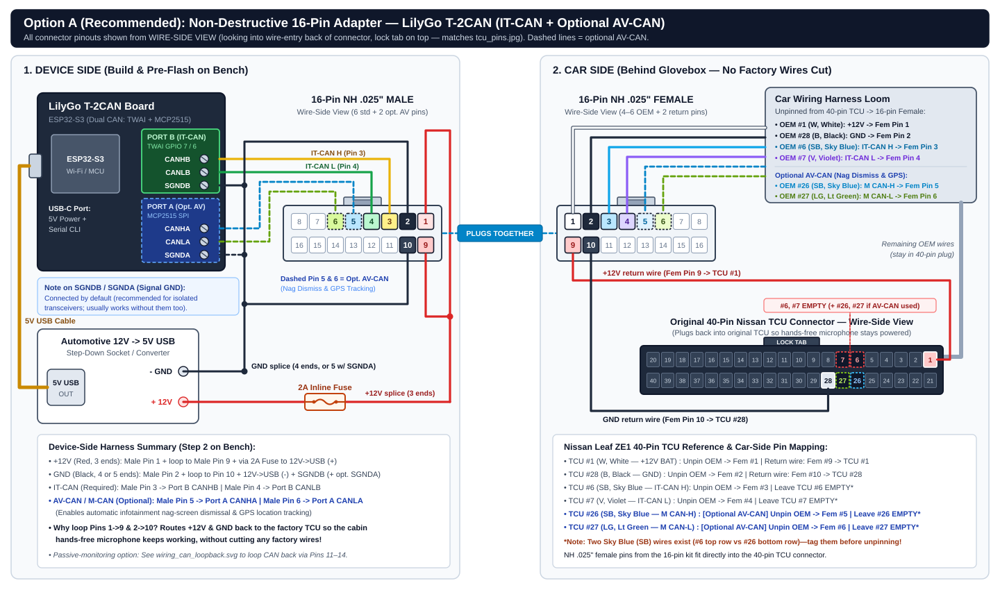
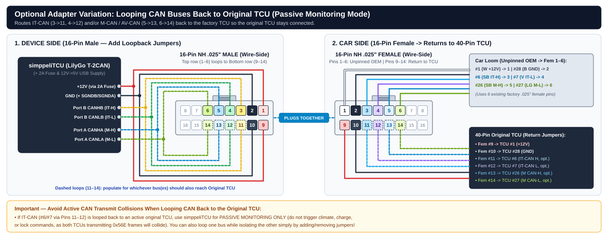
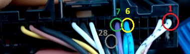

# Installation Guide (Nissan Leaf ZE1)

This guide covers wiring and installing `simppeliTCU` in place of (or alongside) the Nissan Leaf ZE1 Telematics Control Unit (TCU) behind the glovebox.

## Overview & Choosing an Installation Approach

To let `simppeliTCU` control climate, charging, and door locks on the car's `IT-CAN` bus without conflicting with the factory TCU, the two `IT-CAN` wires (**Pin `#6` IT-CAN H** and **Pin `#7` IT-CAN L**) are disconnected from the original 40-pin TCU plug and routed to your ESP32 CAN board.

* **Dual-CAN (`IT-CAN` + `AV-CAN` on LilyGo T-2CAN):** You can also optionally connect the car's `AV-CAN` / multimedia bus (**Pin `#26` M CAN-H** and **Pin `#27` M CAN-L**) to the LilyGo's second CAN interface (**Port A**) to enable **automatic infotainment nag-screen dismissal** and **GPS location tracking**.
* **Standalone `AV-CAN`-Only Setup (e.g., Waveshare or single LilyGo port):** Neither nag-screen dismissal nor GPS tracking depends on `IT-CAN`—even reverse-gear detection (`0x421`) is present directly on `AV-CAN`. If you **only** want nag-screen dismissal and/or GPS tracking, you can connect a single-CAN board (such as the **Waveshare ESP32-S3-RS485-CAN**) solely to `AV-CAN` (`#26` & `#27`), leaving `IT-CAN` (`#6` & `#7`) untouched in the original TCU! *(In an `AV-CAN`-only setup, avoid triggering climate/charge/lock commands so `IT-CAN` wakeup frames aren't sent onto `AV-CAN`.)*

**Why keep `+12V` (`#1`) and `GND` (`#28`) connected to the original TCU?**
The car's **hands-free phone microphone** routes through the original TCU. If you unplug the TCU completely (or leave its power pins disconnected), `simppeliTCU` works fine, **but the cabin hands-free microphone will stop working**. Looping `+12V` and `GND` back to the factory TCU keeps the microphone working normally while isolating the TCU from the CAN bus(es).

You can choose from the following car-side wiring approaches:

| Approach | Factory Wires Cut/Spliced? | Hands-Free Mic Works? | Summary |
| :--- | :---: | :---: | :--- |
| **Option A (Recommended): 16-Pin Sumitomo Adapter** | **No** (100% reversible) | **Yes** | Unpin `#1, #6, #7, #28` (plus optional `#26, #27` for AV-CAN) from the 40-pin TCU plug into a 16-pin NH `.025"` Female housing, and loop `+12V` & `GND` back into TCU `#1` & `#28` via pins `9` & `10`. |
| **Option A + CAN Loopback (Passive Monitoring Mode)** | **No** (100% reversible) | **Yes** | Same 16-pin adapter, plus optional jumpers (`3->11, 4->12` and/or `5->13, 6->14`) looping `IT-CAN` and/or `M-CAN` back to the original TCU when using `simppeliTCU` solely for passive monitoring while keeping the original TCU active for control. |
| **Option B: CAN-Only Unpin + Power Tap** | Power wires tapped | **Yes** | Unpin only `#6` & `#7` (plus optional `#26` & `#27`) from the 40-pin TCU plug, leave `#1` & `#28` plugged into the TCU, and tap `+12V` (with a 2A fuse) & `GND` using Posi-Tap, Wago 221, or solder. |
| **Option C: Original TCU Unplugged** | **No** | **No** | Leave the 40-pin plug disconnected from the original TCU and route only `#1, #6, #7, #28` (plus optional `#26, #27`) to `simppeliTCU`. |

> **Why is there a 16-pin connector in Option A?**
> The male/female Sumitomo connector behind the glovebox exists so you can adapt the unpinned factory terminals cleanly **without cutting or splicing any original car wires**. It is **not** intended to be unplugged for routine firmware updates (unplugging it also disconnects power to the factory TCU). For firmware updates, route the board or a USB cable into the glovebox and flash directly over USB-C—see [Updating Firmware in the Car](#updating-firmware-in-the-car).

---

## Wiring Diagrams

*All connector pinout grids in the diagrams below are drawn from the **Wire-Side View** (looking into the back of the connector where wires enter, with the locking tab at the top—matching the photo in Step 6).*

### Option A (Recommended): Non-Destructive 16-Pin Adapter — LilyGo T-2CAN (`IT-CAN` + Optional `AV-CAN`)

### Alternative Controller: Waveshare ESP32-S3-RS485-CAN (Single CAN — `IT-CAN` or `AV-CAN`)
If using the **Waveshare ESP32-S3-RS485-CAN**, its built-in `DC 7–36V` regulator accepts fused nominal `12V` directly (no external 12V-to-5V USB converter needed). Because it has a **single CAN interface**, wire its `CAN-H` / `CAN-L` terminals **either** to `IT-CAN` (`Pins 3 & 4` <- TCU `#6/#7` for climate/charging/locks/metrics) **or** to `AV-CAN` (`Pins 5 & 6` <- TCU `#26/#27` for standalone nag-screen dismissal & GPS tracking)—never bridge both CAN buses onto the same transceiver!

### Optional Variation: Looping CAN Back to Original TCU (Passive Monitoring Mode)
If you want to use `simppeliTCU` strictly for **passive monitoring** while keeping the original Nissan TCU active for control (or if you want to keep one CAN bus connected to the original TCU while isolating the other), you can loop the CAN pairs through bottom-row pins `11–14`:

> **Warning — Avoid Active CAN Transmit Collisions:** If `IT-CAN` (`#6/#7`) remains connected to an active original TCU via pins `11–12`, **do not send active `IT-CAN` control commands** (climate, charge, or lock/unlock) from `simppeliTCU`, as both modules transmitting `0x56E` frames on the same bus will conflict. Likewise, if keeping the original TCU on `AV-CAN` for purely passive logging without transmitting button frames, disable nag dismissal via `set nag_dismiss false`.

### Simplified Car-Side Alternatives (Option B & Option C)

*(All four diagrams are generated by [`docs/generate_diagrams.py`](generate_diagrams.py) for easy maintenance.)*

---

## Master Pinout & Wire Reference (Option A)

| Signal | OEM Wire Color | Original 40-Pin TCU Cavity | 16-Pin Female (Car Side) | 16-Pin Male (Device Side) | Device-Side Destination |
| :--- | :--- | :--- | :---: | :---: | :--- |
| **+12V (BAT)** | White (`W`) | Unpinned from **#1** | **Pin 1** *(OEM pin)* | **Pin 1** | Splits (3 ends): **2A Inline Fuse -> 12V-to-USB `+`** *(or Waveshare `DC +`)* AND loops to **Male Pin 9** |
| **GND** | Black (`B`) | Unpinned from **#28** | **Pin 2** *(OEM pin)* | **Pin 2** | Splits (4–5 ends on LilyGo): **12V-to-USB `-`**, **LilyGo `SGNDB`**, *(optional **`SGNDA`**)*, AND loops to **Male Pin 10** *(3 ends on Waveshare -> `DC -` & Pin 10)* |
| **IT-CAN H** | Sky Blue (`SB`)* | Unpinned from **#6** *(leave #6 empty)* | **Pin 3** *(OEM pin)* | **Pin 3** | **LilyGo Port B `CANHB`** *(or Waveshare `CAN-H`)* |
| **IT-CAN L** | Violet (`V`) | Unpinned from **#7** *(leave #7 empty)* | **Pin 4** *(OEM pin)* | **Pin 4** | **LilyGo Port B `CANLB`** *(or Waveshare `CAN-L`)* |
| **M CAN-H** *(Opt. AV-CAN)* | Sky Blue (`SB`)* | Unpinned from **#26** *(leave #26 empty)* | **Pin 5** *(OEM pin)* | **Pin 5** | **LilyGo Port A `CANHA`** *(or Waveshare `CAN-H` in standalone AV-CAN mode)* |
| **M CAN-L** *(Opt. AV-CAN)* | Light Green (`LG`) | Unpinned from **#27** *(leave #27 empty)* | **Pin 6** *(OEM pin)* | **Pin 6** | **LilyGo Port A `CANLA`** *(or Waveshare `CAN-L` in standalone AV-CAN mode)* |
| **+12V TCU Return** | Red *(new wire)* | Inserted into **#1** *(new female pin)* | **Pin 9** *(new female pin)* | **Pin 9** | Receives looped `+12V` from **Male Pin 1** (powers original TCU mic) |
| **GND TCU Return** | Black *(new wire)* | Inserted into **#28** *(new female pin)* | **Pin 10** *(new female pin)* | **Pin 10** | Receives looped `GND` from **Male Pin 2** (grounds original TCU mic) |
| *Opt. CAN Returns* | *Matching colors* | *Inserted into **#6, #7, #26, #27*** | ***Pins 11–14*** | ***Pins 11–14*** | *Optional passive-monitoring loopbacks from **Male Pins 3–6*** |

* **⚠️ Two Sky Blue (`SB`) wires (`#6` vs `#26`):** If you unpin both `IT-CAN` and `AV-CAN`, note that **both `#6` (`IT-CAN H`, top row) and `#26` (`M CAN-H`, bottom row directly underneath `#6`) are Sky Blue (`SB`)**! Label `#6` or unpin and insert one CAN pair at a time so `#6` stays paired with `#7` (`Violet`) and `#26` stays paired with `#27` (`Light Green`). Swapping `#6` and `#26` will mis-pair the differential CAN pairs and prevent both buses from working.
* **Connector pin numbering flexibility:** Which exact slots you use inside the 16-pin Sumitomo connector does not matter electrically, **as long as every pin on the Male side lines up with the matching signal on the Female side** (remembering that Male and Female Wire-Side views are horizontal mirror images).
* **Note on `SGNDB` & `SGNDA` (Signal Ground):** Connecting `SGNDB` (and `SGNDA` when using Port A) to ground is included by default and recommended for boards with isolated CAN transceivers so the bus side does not float, although the board will most likely function without them connected as well.

---

## Required Tools and Parts

### Tools
* Cross / Phillips screwdriver (for removing the glovebox and TCU bracket)
* Terminal unpinning pick or very small jeweler's flat screwdriver (for releasing the 40-pin TCU lock & terminals)
* Open-barrel terminal crimping tool (recommended) or fine needle-nose pliers + soldering iron

### Parts & Accessories
* **Controller & Power Supply (choose one):**
  * **LilyGo T-2CAN** + **Automotive 12V-to-5V USB converter** (e.g., [Motonet 12V USB socket](https://www.motonet.fi/tuote/four-vedenpitava-usb-pistorasia-12-24-v?product=65-01122)) + **USB-A to USB-C cable** *(NEVER connect automotive 12V directly to the LilyGo board!)*
  * *Alternative (Single CAN — `IT-CAN` or `AV-CAN`):* **Waveshare ESP32-S3-RS485-CAN** (connects via fused 12V & GND directly to its `DC 7–36V` screw terminals; no separate 12V-to-5V USB converter needed)
* **Inline fuse holder + 2A automotive fuse** (1A–3A blade or glass fuse on the `+12V` line feeding your converter/Waveshare; note that some flush-mount 12V USB sockets already come with a pre-wired inline fuse)
* **For Option A:** **16-Pin Sumitomo NH `.025"` Male & Female connector kit** (e.g., [Eastern Beaver 16-Pin Sumitomo NH .025" Connector](https://www.easternbeaver.com/product/16-pin-sumitomo-nh-025-connector/))
  * *Terminal compatibility:* The NH `.025"` female terminals in this kit fit directly into the Nissan 40-pin TCU connector. One 16-pin kit includes 16 male + 16 female pins, which is plenty even with optional `AV-CAN` and loopback jumpers (**6–12 male pins** + **4–12 new female pins**; unpinned OEM wires reuse their factory terminals).
* Automotive stranded wire (`0.35–0.5 mm²` / `22–20 AWG`, sized for `.025"` terminals) and heat-shrink tubing / electrical tape.

---

## Phase 1: Bench Preparation (Before Going to the Car)

Doing the flashing, initial setup, and crimping indoors at a desk makes the in-car work much faster and easier.

1. **Flash Firmware & Configure Settings on Your Computer:**
   * Connect your board to your computer via USB-C and flash the firmware using either:
     * **[Pre-compiled Binaries Flashing Guide](flashing.md)** *(easiest — download the `.bin` for your board from GitHub Releases)*, or
     * **[Compiling and Uploading Guide](compiling.md)** *(build from source with Arduino IDE or Arduino CLI)*.
   * Open a serial monitor at **115200 baud** (with Newline `\n` or Carriage Return `\r` enabled) and set your Wi-Fi / AP / MQTT configuration (e.g., `set ssid MyWiFi`, `set password MySecret`, `reboot` — see [README Configuration](../README.md#configuration)). If connecting `AV-CAN` and you want GPS location tracking enabled, also run `set tracking true`.

2. **Build the Device-Side Harness (Option A — 16-Pin Male Housing):**
   * **2.1. CAN wires:**
     * **IT-CAN (Required):** Crimp NH `.025"` **male** terminals onto one end of two wires (`IT-CAN H` for Male Pin `3`, `IT-CAN L` for Male Pin `4`). Screw the stripped ends into **LilyGo Port B `CANHB`** and **`CANLB`** *(or Waveshare `CAN-H` and `CAN-L`)*.
     * **AV-CAN / M-CAN (Optional, LilyGo T-2CAN only):** Crimp NH `.025"` **male** terminals onto two more wires (`M CAN-H` for Male Pin `5`, `M CAN-L` for Male Pin `6`) and screw the stripped ends into **LilyGo Port A `CANHA`** and **`CANLA`**.
   * **2.2. `+12V` Y-split wire (3 ends total):** Join three wire branches (by crimping or soldering + heat-shrink):
     1. NH `.025"` **male** pin -> **Male Pin `1`** (`+12V` input from car)
     2. NH `.025"` **male** pin -> **Male Pin `9`** (`+12V` loopback to original TCU)
     3. **2A inline fuse** -> **12V-to-USB converter `+`** terminal *(or Waveshare `DC +`)*
   * **2.3. `GND` split wire (4 ends for LilyGo IT-CAN; 5 ends with AV-CAN; 3 ends for Waveshare):** Join the ground branches:
     1. NH `.025"` **male** pin -> **Male Pin `2`** (`GND` input from car)
     2. NH `.025"` **male** pin -> **Male Pin `10`** (`GND` loopback to original TCU)
     3. **12V-to-USB converter `-`** terminal *(or Waveshare `DC -`)*
     4. *(LilyGo T-2CAN)* **LilyGo Port B `SGNDB`** screw terminal
     5. *(Optional, LilyGo T-2CAN with AV-CAN)* **LilyGo Port A `SGNDA`** screw terminal
   * **2.4. Insert & lock Male pins:** Release/open the secondary terminal lock on the **16-pin Male housing**, insert all prepared male terminals (`1, 2, 3, 4, 9, 10`, plus optional `5, 6` for AV-CAN and optional `11–14` if building the passive-monitoring loopback) from the wire side until each clicks, gently tug-test each wire, and **press the Male housing's secondary lock closed**.

3. **Build the Short TCU Return Wires (Option A Only):**
   * Cut two short (~10–15 cm) wires (one red for `+12V`, one black for `GND`) and crimp an NH `.025"` **female** terminal onto **both ends** of each wire (4 female terminals total). *(If also using the optional CAN loopback for passive monitoring, make matching female-to-female jumper wires for pins `11–14` as well.)*

---

## Phase 2: In-Car Installation

4. **Put the Car to Sleep & Disconnect the Negative 12V Battery Terminal:**
   * **4.1.** Turn the car power ON and then OFF, close all doors, and **wait at least 5 minutes** for the car's ECUs and CAN buses to go to sleep.
   * **4.2.** Disconnect the **negative (`-`) terminal** of the 12V battery under the hood.

5. **Remove Glovebox & Unplug the Original TCU:**
   * Remove the glovebox (see [LHD ZE1 Leaf video tutorial](https://youtu.be/kyx2A4U-M1M?si=YGewj1TeBEfrpOKV)).
   * Unbolt/remove the TCU bracket behind the glovebox and detach its black **40-pin connector**.

6. **Unpin the Required Wires from the 40-Pin TCU Connector:**

   
   *(In the Wire-Side View above, `#26` [Sky Blue, M CAN-H] sits directly below `#6`, and `#27` [Light Green, M CAN-L] sits directly below `#7`, right next to `#28` [Black, GND].)*

   * **6.1.** Unclip and remove the white plastic protective end cap from the mating face of the 40-pin connector (opposite side from the wires):

     

   * **6.2.** Release the secondary terminal locking bar on the side of the 40-pin connector housing. *(Tip: Prying this lock bar up to its unlocked position takes patience and a small flat screwdriver/pick—work gently from each end so the plastic tabs don't crack.)*
   * **6.3.** Using a fine unpinning pick from the front face, lift the internal plastic locking lance inside each cavity while gently pulling the wire out from the back:
     * **Standard IT-CAN (`Option A / C`):** Extract **`#1`** (White `+12V`), **`#6`** (Sky Blue `IT-CAN H`), **`#7`** (Violet `IT-CAN L`), and **`#28`** (Black `GND`).
     * **Optional AV-CAN (`Nag Dismiss & GPS`):** Also extract **`#26`** (Sky Blue `M CAN-H`) and **`#27`** (Light Green `M CAN-L`)—**label `#6` vs `#26` immediately** since both are Sky Blue!
     * **Option B:** Extract only the CAN wires (`#6, #7`, plus optional `#26, #27`); leave `#1` and `#28` in the connector and tap them on the harness, avoiding insulation-displacement clips (*"rosvoliitin"*) on CAN data wires.

7. **Populate & Lock the 16-Pin Female Housing (Option A):**
   * Release/open the secondary lock on the new **16-pin Female housing**.
   * Push the unpinned factory wires into the wire side of the Female housing until each clicks:
     * Factory **`#1` (White, `+12V`)** -> **Female Pin `1`**
     * Factory **`#28` (Black, `GND`)** -> **Female Pin `2`**
     * Factory **`#6` (Sky Blue, `IT-CAN H`)** -> **Female Pin `3`**
     * Factory **`#7` (Violet, `IT-CAN L`)** -> **Female Pin `4`**
     * *(Optional AV-CAN)* Factory **`#26` (Sky Blue, `M CAN-H`)** -> **Female Pin `5`**
     * *(Optional AV-CAN)* Factory **`#27` (Light Green, `M CAN-L`)** -> **Female Pin `6`**
   * Push one end of the short red return wire into **Female Pin `9`**, and one end of the short black return wire into **Female Pin `10`** *(plus `11–14` if building the passive-monitoring CAN loopback)*.
   * Tug-test all wires, then **press the 16-pin Female housing's secondary lock closed**.

8. **Insert Return Wires & Re-Lock the 40-Pin TCU Connector (Option A):**
   * Push the free end of the short red return wire (from Female Pin `9`) into **40-pin TCU cavity `#1`**, and the free end of the short black return wire (from Female Pin `10`) into **40-pin TCU cavity `#28`** until they click. Leave `#6` & `#7` (and `#26` & `#27` if unpinned) empty *(unless using the passive-monitoring CAN loopback via `11–14`)*.
   * **Press the 40-pin connector's secondary locking bar back down into its locked position** and **snap the white protective end cap back onto the front**.
   * **Plug the 40-pin connector back into the original TCU** until its main latch clicks, then bolt the TCU back into its mounting bracket.

9. **Connect Adapter, Position Board & Reassemble:**
   * Mate the **16-pin Male and Female Sumitomo connectors** together until they click.
   * Secure the 12V-to-USB converter and 2A inline fuse behind the glovebox area so nothing rattles.
   * Place the `simppeliTCU` board (in an enclosure) in a convenient spot. **Tip:** Route the board or USB cable into the **glovebox through the small access hatch on the side of the glovebox**—this makes future USB-C firmware updates effortless without removing the glovebox again.
   * Double-check all connections (`+12V` vs `GND` polarity, `2A` inline fuse installed, `IT-CAN` vs `AV-CAN` pairs).
   * Reinstall the glovebox, **reconnect the negative (`-`) 12V battery terminal**, and plug the USB power cable into the 12V USB converter to power up `simppeliTCU`.

---

## Updating Firmware in the Car

When a new `simppeliTCU` version is released, **you do not need to access the wiring behind the glovebox or unplug the 16-pin Sumitomo connector**:

* **LilyGo T-2CAN:** Open the glovebox (with the car parked/off). Unplug the USB cable from the car's 12V USB socket (or unplug the USB-C end from the LilyGo), connect your laptop directly to the LilyGo's USB-C port, flash the update using the [Pre-compiled Binaries Guide](flashing.md) or [Compiling Guide](compiling.md), and plug the car's 5V USB power cable back in. *(The CAN screw terminals can stay connected during flashing, and your Wi-Fi/MQTT settings in persistent memory are preserved.)*
* **Waveshare ESP32-S3-RS485-CAN:** Pull the inline 2A fuse (or disconnect the `DC 7–36V` terminal block) before connecting your laptop to the board's USB-C port so the board is only powered from one source during flashing, flash the update, and reconnect the 2A fuse / DC terminal.
