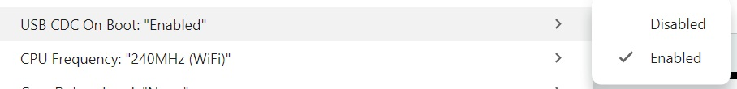

# Compiling and Flashing Firmware

## Compiling and Uploading with Arduino IDE

To compile and upload the firmware for the Lilygo T-2CAN board using the Arduino IDE, please configure the following settings:

1. **Board Selection**: Select **ESP32S3 Dev Module** as your target board.
   * If you haven't set up the ESP32 core yet, please follow the [LilyGO T-2CAN Quick Start Guide](https://wiki.lilygo.cc/get_started/en/High_speed/T-2Can/T-2Can.html#Quick-Start) to download the required board files.
   
   

2. **Serial Output Configuration**: **USB CDC On Boot** needs to be set to **"Enabled"** for the printouts to appear in the Serial Monitor.
   
   

## Compiling and Uploading with Arduino CLI

If you prefer using the command line, you can build and flash the firmware using the [Arduino CLI](https://arduino.github.io/arduino-cli/).

1. **Install the ESP32 core and required libraries**:
   ```bash
   arduino-cli core update-index --additional-urls https://espressif.github.io/arduino-esp32/package_esp32_index.json
   arduino-cli core install esp32:esp32 --additional-urls https://espressif.github.io/arduino-esp32/package_esp32_index.json
   arduino-cli lib install PubSubClient
    arduino-cli lib install autowp-mcp2515
   ```

2. **Compile the sketch** (ensuring USB CDC On Boot is enabled, and optionally embedding the current git commit hash):
   ```bash
   arduino-cli compile --fqbn esp32:esp32:esp32s3:CDCOnBoot=cdc \
     --build-property "compiler.cpp.extra_flags=-DGIT_HASH_RAW=$(git rev-parse --short HEAD)" \
     simppeliTCU
   ```
   *(If compiled in Arduino IDE or without `GIT_HASH_RAW`, the version string in `simppeliTCU/version.h` defaults to showing `(local)` as the commit hash.)*

3. **Upload to the board** (replace `<PORT>` with your COM port, e.g., `COM3` or `/dev/cu.usbserial...`):
   ```bash
   arduino-cli upload -p <PORT> --fqbn esp32:esp32:esp32s3:CDCOnBoot=cdc simppeliTCU
   ```

## Running Unit Tests

### Prerequisites

- CMake 3.14+
- MinGW or Visual Studio (Windows)
- Git (for FetchContent to download Google Test)

### Commands

```bash
# Navigate to test directory
cd test

# Create and enter build directory
mkdir build
cd build

# Configure with MinGW
cmake -G "MinGW Makefiles" ..

# Build the tests
cmake --build .

# Run all tests
ctest
```

## Creating a New Release

Releases are created automatically by GitHub Actions when the version is bumped on the `main` branch:

1. Update [`CHANGELOG.md`](../CHANGELOG.md): move or add the changes under a new version heading (e.g., `## [v0.1.1] - YYYY-MM-DD`).
2. Update [`simppeliTCU/version.h`](../simppeliTCU/version.h): bump `FW_VERSION` to the matching version string (e.g., `#define FW_VERSION "v0.1.1"`).
3. Commit and push/merge the changes to `main`.

When the workflow runs on `main` and detects that a git tag for `FW_VERSION` does not yet exist, it automatically:
- Embeds the short git commit hash into the firmware binaries.
- Creates and pushes the annotated git tag (e.g., `v0.1.1`).
- Extracts the matching release notes from `CHANGELOG.md`.
- Publishes a **GitHub Release** with the compiled firmware binaries (`.bin` and `.zip`) for all supported boards.


